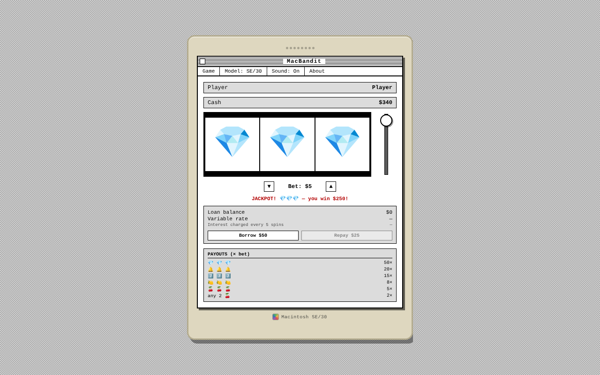

# MacBandit

A slot machine in a classic Macintosh window. Pull the handle, chase the diamonds, and try not to drown in loans.

*Jackpot! Three diamonds*

## What's in it

- Enter your name, set your bet and pull the handle
- Payouts: three diamonds pay 50×, bells 20×, sevens 15×, plus lemons, cherries and any two cherries
- Borrow $50 when you're low, and repay $25 at a time. Interest is charged every 5 spins at a variable rate
- Switch the Mac model and toggle sound from the menu bar

## Run it

Download `macbandit.html` and open it in your web browser. No install, no account, nothing to set up.

---
Made by hardwaremack.
